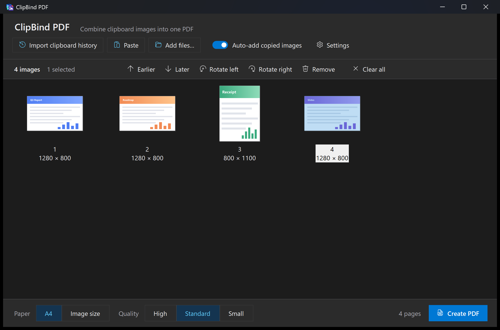
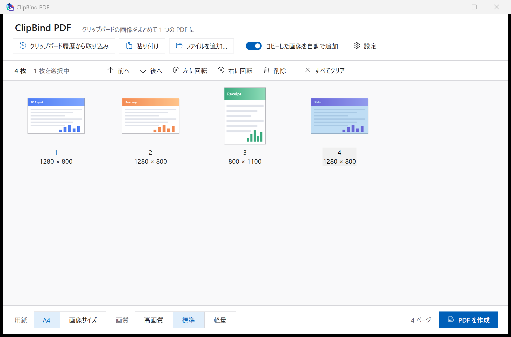

# ClipBind PDF

**Combine clipboard images into one PDF — for Windows.**
クリップボードの画像をまとめて 1 つの PDF にする Windows アプリ。

[English](#english) · [日本語](#日本語)



## Download / ダウンロード

Get the installer from **[Releases](https://github.com/Kou-256/ClipBind-PDF/releases/latest)** (`ClipBindPDF-Setup-x.y.z.exe`).
No .NET installation needed. Windows 10 (1809) or later, 64-bit.

インストーラーは **[Releases](https://github.com/Kou-256/ClipBind-PDF/releases/latest)** から。.NET のインストールは不要です。Windows 10 (1809) 以降・64 ビット。

---

## English

- **Auto-add** — every image you copy (screenshots, images from a browser…) is added to the list automatically.
- **Import clipboard history** — load all images in your Win+V history at once, in the order you copied them.
- **Arrange** — drag to reorder, rotate, remove, undo.
- **Create PDF** — A4 (portrait/landscape chosen per image) or one page per image size, three quality levels.
- **Settings** — file name template (`{date}`, `{time}`, `{pages}`), save folder (Downloads by default), save without asking, open after saving.
- Light / dark theme, Japanese / English UI, crisp on high-DPI and mixed-DPI monitors.

| Shortcut | Action |
| --- | --- |
| Ctrl+V | Paste image |
| Ctrl+H | Import clipboard history |
| Ctrl+O | Add files |
| Ctrl+S | Create PDF |
| Ctrl+Z | Undo remove |
| Alt+← / → | Move earlier / later |
| Ctrl+L / Ctrl+R | Rotate left / right |
| Ctrl+, | Settings |

## 日本語

- **自動追加** — 画像をコピーするたびに一覧へ追加（スクリーンショット、ブラウザーの画像など）。
- **クリップボード履歴から取り込み** — Win+V の履歴にある画像を、コピーした順にまとめて追加。
- **並べ替え** — ドラッグで並べ替え、回転、削除、元に戻す。
- **PDF を作成** — A4（画像ごとに縦横を自動選択）または画像サイズのページ。画質は 3 段階。
- **設定** — ファイル名のテンプレート（`{date}` `{time}` `{pages}`）、保存先（既定はダウンロード）、確認せずに保存、保存後に開く。
- ライト / ダーク、日本語 / 英語に対応。高 DPI や倍率の違うマルチモニターでもくっきり表示。



## Build / ビルド

Requires the .NET 10 SDK and [Inno Setup 6](https://jrsoftware.org/isinfo.php).

```powershell
powershell -ExecutionPolicy Bypass -File build.ps1   # -> dist\ClipBindPDF-Setup-<version>.exe
```

For a quick run without the installer: `dotnet run -c Release`.
